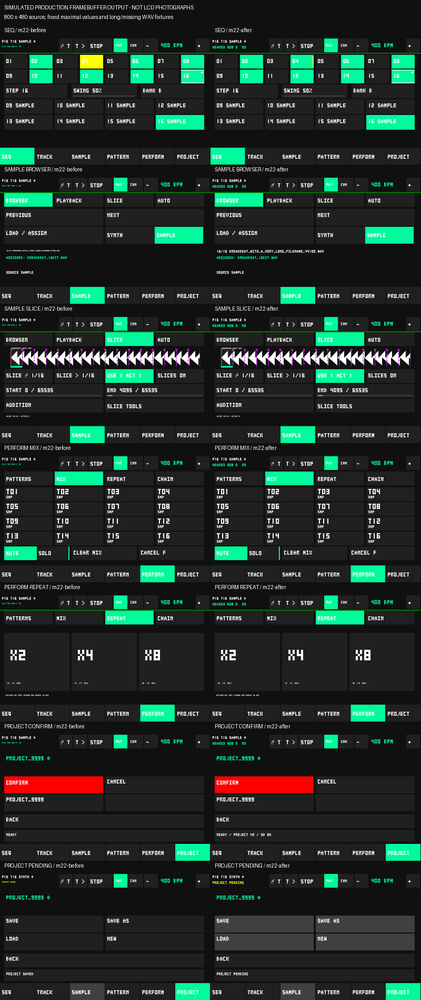

# M22 — touchscreen groovebox refinement

**PARTIAL — human touchscreen UX acceptance pending.** Automated and device
qualification results below are independent of human finger/listening acceptance.
No M23 work, DSP changes, migration, or persistent UI fields are included.

## 1. Baseline and reproducibility

Source/main: `72a9178957a2cf048e05cf86ce403509756284df`, verified against fetched
`origin/main`. The existing untracked `docs/m21/error.png` was preserved.
Before firmware edits, `guition_app` and `guition_app_nearest_legacy` built,
the inherited host suite passed **108/108**, and the real production drawing
functions rendered all views. Baseline builds and source/package/hash manifests
are archived under `.pio/m22-artifacts/baseline/`.

Use `C:/.platformio/penv/Scripts/python.exe -m platformio` on this workstation:
the default Python 3.14 is unsupported by the pinned platform; the repository
3.13 environment also picks up 3.11 binary extensions from PlatformIO's penv.
The existing PlatformIO 3.11.7 environment builds successfully. This is a host
toolchain issue, not a firmware change.

Baseline serial startup verifies ES8311, 44,100/16 I2S, SD 4-bit/20 MHz and
nine indexed entries. It does not establish finger interaction or listening.
Inherited M21.4 device logs remain historical timing evidence; final M22
captures must pass the original strict analyzer independently.

## 2. Interface audit

Evidence labels: **S** = source-derived; **R** = inspected host framebuffer;
**H** = physical human observation. No H observation is inferred from S/R.

| Section / subtabs | Findings and retained workflow | Evidence |
|---|---|---|
| SEQ | Pads select and audition; steps toggle directly and select for EDIT STEP. Bank A/B retains selected Track/Step. White step edges identify inspection; originally the yellow playhead replaced the entire ON/OFF fill. Track activity similarly replaced selection fill. Separate activity stripes now preserve canonical fill. Tempo +/- remains in the header. | S,R |
| TRACK Main / Tone | Track/source context persists in header. Main has volume, pan, pitch, length, wave, mute/solo, source and Sample entry; Tone has cutoff/resonance/send/Delay. SYNTH-only wave/length are guarded. Source changes force complete context refresh. Sliders own a drag even beyond their rectangle and clamp at endpoints. | S,R |
| SAMPLE Browser / Playback / Slice / Auto / Slice Tools | Browser requests asynchronous WAV load, with status from storage completion. Browser filename was scale 1; now scale 2 and still bounded. Playback exposes region/reverse/mode/choke. Slice VIEW remains separate from USE ACT; proposal markers stay magenta/dashed, accepted/inspected boundaries cyan/yellow. Auto Analyze does not apply; Apply waits for accepted acknowledgement. Destructive slice tools require captured-intent confirmation. | S,R |
| PATTERN Select / Step / Basic,Tone,Sample Locks / Tools | Edit, playing and queued Pattern are independent. Inspect does not queue. Step selects metadata for the captured Pattern/Track; lock commands name Pattern/Track/Step explicitly. Unsupported SYNTH/SAMPLE locks are guarded without erasing stored data. Navigation retains selection and cancels hidden destructive intents. | S,R |
| PERFORM Patterns / Mix / Repeat / Chain | E/A/O/F and pending markers distinguish temporary launch from arrangement/editor state; base/temporary mix flags remain separate. Repeat retains accepted-event capture, quantization and Stop retry. Its owner survives navigation until release. Chain rows and controls remain 52 px high; Delete captures intent and Clear confirms. Full redraw scripts exercise page traversal. | S,R |
| PROJECT Home / Naming / Confirm / Load | Captured operation/name survives selection changes; Cancel and navigation clear intent. `request()` can reject busy/unavailable storage; `busy()` represents pending work. Only successful verified storage save reports PROJECT SAVED (`projects.cpp`). Load validates before apply, stops transport and restores samples incrementally; missing names remain SAMPLE/silent. CRC/recovery codec tests are inherited. | S,R |

Two additional S concerns were corrected: sample/project request rejection was
silent, and Project request publication increments revision before the storage
status necessarily changes. UI reports REQUESTED, PENDING and REJECTED, watches
busy transitions independently of revision, and disables pending Project actions.
A previous SAVED notification cannot replace pending status in header or Project
row. Completion/error still comes from storage; persistence is unchanged.

Source geometry tests cover all nineteen pages, footer/header, edge pixels,
nonoverlap and minimum **52×52** actionable rectangles. Segments use the same
registry parent and shared subdivision as drawing/hit testing; no thin slider
handle is an independent target. Existing slider arithmetic clamps drag beyond
edges. Disabled controls remain visibly muted or labeled unsupported and reject
unsupported actions. No new long-press shortcuts are introduced.

Common paths: Track pad → step → EDIT STEP → velocity/probability → SEQ;
Track pad → SAMPLE → previous/next → LOAD → Playback/Slice/Auto; PATTERN →
Step/Locks; PERFORM → Patterns/Mix/Repeat/Chain; PROJECT → Save/Save As/Load/New.
All footer destinations take one tap. Exact repeated file-browser tap counts
depend on index position. Physical legibility, missed touches and relative
responsiveness are pending H observations.

## 3. Visual evidence

These images are **simulated output from the actual production framebuffer
renderer**, not LCD photographs or handcrafted mockups. Fixtures include Track
16, Pattern 16, BPM 400, maximal locks, 16 slices, Chain x16, long filenames,
missing sample/error state, SYNTH-disabled playback, Project Confirm and Load.

[All sections/subtabs](m22/sections.png). Reproduce with
`python tests/m22_screens.py`; the before source is the exact M21.4 merge, not
the older M19 `render_ui.py --baseline` mode. Correct enum-to-label mapping is
derived from the production Page enum. Rendering asserts zero allocations.

## 4. Changes by section and renderer

SEQ preserves ON/OFF and selected Track fills during playhead/sounding activity
using an independent yellow right-edge stripe. The selected Step keeps white
top/bottom borders and locks keep their small marker. All sections get scale-2
HEAR/queued/Repeat status. SAMPLE browser filenames use scale 2. All text remains
bounded, with clipping and truncation; no new font package is used.

Full-page rendering skips header controls already drawn by `header()`.
The 3×5 font merges identical adjacent rows and contiguous lit bits into
rectangles, with exactly unchanged glyph pixels. Exhaustive production-font
comparison at scales 1/2/3/4/8, clipped positions and ASCII 32–126 passes:
**41,400 → 19,080 rectangle calls** (53.9% fewer in that fixture). This is a
draw-call result, not a claimed 53.9% device speedup. Existing waveform bins,
framebuffers, dirty tiles, repair histories and display fence are retained.

## 5. Workflows A–E

| Workflow | Automated status | Human status |
|---|---|---|
| A: beat, Track/bank/step/tempo/velocity/probability, return | Inherited navigation, geometry, model, groove and rendering checks | Pending |
| B: WAV/region/slice/audition/transients Apply/Cancel | Inherited parser/ownership/waveform/slice/transient-service tests; real SD qualification reported separately | Pending |
| C: expressive Step/locks and editor/playback context | Explicit command context, unsupported lock/source tests, immutable event replay | Pending |
| D: Override/Fill/Mix/Repeat/Chain | Inherited scheduling/equivalence; added gesture/release overflow checks | Pending |
| E: Save/Save As/Load/New/cancel/recovery/missing | Inherited codec, captured modal intent and recovery tests; final real SD evidence reported separately | Pending |

## 6. Touch path and ownership

GT911 polls at an 8 ms task delay plus I2C work (10 ms individual transaction
timeout). Native bounds/orientation are validated before logical hit testing.
The touch task publishes bounded SPSC UI packets and independently queues pad
audio, so accepted audio and displayed UI are distinct boundaries.

UI packets now carry the observation timestamp, initial-press flag and release
generation. A dropped release cannot leave UI `down` latched. Reconciling the
independent generation cancels the old capture and releases its slice audition
and Repeat owners; a saturated command queue retains the existing release
retry. A move whose press was dropped cannot become an unrelated tap. Release
never hit-tests another widget. Navigation clears capture but preserves the
original release owner. Source/Track/sample/Project context replacement clears
capture and releases held owners, preventing a drag from silently retargeting.
Three consecutive failed GT911 polls cancel a held gesture through the same
release generation. Recovery suppresses the stale held state until a real
release is observed; it cannot replay the previous press. Deterministic tests
cover transient-error recovery, one cancellation and lift/repress gating.

No audio command kind, queue acceptance rule or musical Repeat window changed.
The GT911's last state intentionally persists between nonfresh packets; if the
controller never supplies a release packet, software cannot distinguish a
legitimate long hold from controller failure. No guessed hold timeout was
introduced. Actual controller-failure behavior remains a physical acceptance
item. Independent generation covers a missed UI queue event, not an unobserved
physical lift that never reached the controller reader.

## 7. Bounded response instrumentation

Eight fixed 256-bin histograms (1 ms bins, separate overflow/max) measure:
poll-call duration, observation-to-dispatch, dispatch/state-update, command
enqueue-to-observed audio acknowledgement, redraw preparation, present-call
duration, full-page preparation and controller-observation-to-display-submission.
They allocate no memory and do not instrument pixels/audio callbacks.
Quantiles are explicitly labeled **upper bounds**; overflow uses measured max.
The acknowledgement boundary is observed by the UI from the existing audio
publication; it includes any UI sampling delay. Poll-call duration cannot
measure the interval from finger contact to the next poll.
The normal application's read-only serial `U` query prints the histograms;
`tests/m22_human_capture.py` requests them every 15 seconds during a walkthrough,
without injecting coordinates or musical commands. Background empty taps and
unowned moves do not start a submission-latency sample. Samples represent
the oldest eligible pending packet in a coalesced redraw, not every individual
packet. Successful controller recovery still requires a fresh observed lift.

Display `present()` telemetry includes repair/cache/transfer/submission work
as provided by the existing HAL; it is not a scanout or visible-pixel timestamp.
Existing completion fences are preserved. Controller event quantiles with zero
events are **not measured**. Redraws under stress mix scripted navigation with
real audio/playhead activity and are labeled accordingly. No camera/photodiode
or observed human touch is available yet. The <120 ms p95 target is pending
genuine human input-to-submission data, and no pixel-visible claim is made.

## 8. Display correctness and task boundaries

Continuous controls retain partial invalidation. Context changes force full
refresh on Track/source/sample/Project/Pattern changes as appropriate, including
sample replacement, transient apply and Project activation. Waveform data is
completed outside audio before publication, never scanned from PCM on redraw.
Full framebuffer clears prevent stale overlays during transitions. Source
inspection and tests do not certify absence of physical scanout artifacts.

Audio/storage ownership, immutable events, sample retirement and Project
snapshot/apply remain unchanged. No blocking SD/audio allocation or new wait
is introduced in touch dispatch. Histograms execute in touch/UI tasks only.

## 9. Physical qualification and human checklist

**HUMAN PHYSICAL UX ACCEPTANCE PENDING.** The user has agreed to a walkthrough
after final firmware restoration. No LCD photos or subjective listening results
have been synthesized. Boot and automated serial stress do not certify fingers.

1. SEQ: select Track, toggle several steps rapidly, change tempo, EDIT STEP,
   velocity/probability, SEQ, bank A/B. Check white selection, yellow activity
   stripe and cyan ON fill remain distinguishable.
2. SAMPLE: load a real indexed WAV; wait for completion; Playback start/end;
   Slice VIEW, USE ACT, audition and release; Auto Analyze then Cancel;
   analyze again and Apply. Confirm magenta proposal was never shown as accepted.
3. PATTERN: inspect another Pattern while playing; Step and Basic/Tone/Sample
   locks; return to SEQ. Confirm Track/Pattern/Step context is correct.
4. PERFORM: Override, Fill, Mix mute/solo; hold each x2/x4/x8, drift outside,
   release, change tab and release; verify normal sequencing resumes. Edit Chain
   while stopped; cancel Delete/Clear confirmations.
5. PROJECT: Save As to a disposable name, wait for SAVED; edit, Save, Load,
   cancel New, confirm New, reload. Check errors/pending status and dirty star.
   Repeat editing while audio plays; report missed touches, clipping, artifacts,
   freezes or audio interruptions. Electrical power-removal recovery is separate.

## 10. Physical SD results

Fresh [SD serial evidence](m22/SD_SERIAL.log) passes `analyze_m22_sd.py`:
indexed WAV loads, replacement/retirement, invalid depth/truncation,
fragmentation/reserve rejection, Project Save/Load, CRC generation fallback
and restoration, three missing references/restoration, and rejected missing
Project preserving current state. Unmount, short-read and allocation failure
are injected failures, not physical card removal/power cutting. Reserved files:
M22_LAYOUT_QUAL / M22_MISSING_QUAL.

The isolated SD console derives from `6936720`, before final touch/pending-message
refinements; loader, DSP, ownership and codec match final source. It is controlled
by serial, not human UI. It recorded 24,816 Repeat hits and twelve Chain loops,
maximum 3,743 µs (35.5% reserve), zero errors and 21 loading/analysis overlap blocks.
p99=3,669 µs covers the first 16,384 of 17,999 measured blocks; maximum/error
counters cover all blocks. No p50/p95 or complete-interval p99 is invented.
The optional dense-component marker is absent; actual timing/hit records and
the passing overall SD gate are reported independently.

## 11. Fresh SAMPLE/SYNTH realtime results

Initial M22 source `6936720` passed both complete real-board runs, before the
additional controller-error cancellation/serial query. SAMPLE p50/p95/p99/max:
2,867/3,732/3,857/4,065 µs (30.0% reserve); SYNTH:
3,738/4,089/4,201/4,402 µs (24.2%). These initial captures are retained separately
and will not substitute for final-source qualification.

Final firmware source: `432abf2aa65857ec03a46e9d1a840c954607dc2a`.
Saved images were hash-verified before flash; production, Nearest, SAMPLE and
SYNTH all compiled successfully.

| Final real-device scripted stress | Blocks | p50 / p95 / p99 / max (µs) | Worst reserve |
|---|---:|---|---:|
| SAMPLE | 13,782 | 2,865 / 3,696 / 3,828 / 4,116 | 29.1% |
| SYNTH | 13,782 | 3,730 / 4,119 / 4,228 / 4,489 | 22.7% |

Both pass the original strict M20→M19→Repeat→Chain analyzer chain, with zero
misses, failures, timeouts, watchdogs or rails. SAMPLE free/largest/internal heap
remains 24,265,192 / 24,117,236 / 208,348 bytes; SYNTH remains
26,427,944 / 26,214,388 / 233,484. Histogram/packet additions cost about 9.3 KB
internal memory versus historical SAMPLE, with stable before/after heap and no
audio allocation.

One final SAMPLE attempt had max=4,116 µs and zero audio errors but **zero Chain
loops**; strict coverage rejected it. It is retained as [rejected capture](m22/REJECTED_SAMPLE_CHAIN_SERIAL.log).
The unchanged saved image was rerun and completed one loop. No analyzer was
weakened and the rejected attempt is not counted as a pass. Wall-clock coverage
variability remains separate from deterministic musical equivalence.

Final SAMPLE redraw p50/p95/p99 upper bounds: 26/95/124 ms; max 145.493 ms.
Full-page upper bounds: 85/129/140 ms. Present-call upper bounds: 1/5/15 ms,
max 20.987 ms. SYNTH full-page preparation upper bounds: 110/153/158 ms,
max 158.056 ms. Native partial slider/playhead transfers remain 49,152 / 24,576
bytes. Historical M21.4 full-page maxima were already 100–146 ms; reduced glyph
calls did not remove that limit. No universal renderer speedup is claimed.
Scripted captures have zero controller events, so input/ack quantiles are not
measured. Human capture and observations remain separate pending evidence.

## 12. Musical event equivalence

The inherited 108-check baseline includes the complete original M21.4 A command
journal replay, canonical event/RNG/transport/voice state and Project bytes.
The final model, voice/sample transport, pitch, filters/Delay, slice/transient
algorithms and Project codec are unchanged. Identical intended commands retain
that equivalence. A wall-clock UI stress capture is not declared byte-identical
to an earlier capture; draw timing can change when scripted commands arrive.

## 13. Persistent compatibility and production configuration

Project remains **V2 / exactly 52,704 bytes**, with no new fields or migration.
Production stays interpolation=1, Linear32=1, magnitude=1, cache=0, placement=1.
Nearest legacy builds independently. New M22 stress environments select the
same production DSP; historical environments/flags remain intact.

## 14. CI and artifacts

The added M22 CI job builds production/fallback/SAMPLE/SYNTH, executes gesture,
font and screenshot checks, verifies production flags and runs strict inherited
analyzers against fresh M22 captures. Firmware ELF/BIN/MAP, build/package/source
hashes and raw serial capture archives are retained. Final remote SUCCESS is
pending; local checks are not substituted for it.
The local suite passed **114/114** after the initial refinement. Added
screenshot assertions use real widget geometry to verify ON fill, yellow
activity stripe, selected white Step edges and selected Track fill; the
contact-sheet regression compares RGB pixels against checked-in evidence.

## 15. Known issues and remaining validation

Physical legibility, minimum-target comfort, missed controller releases, real
finger latency and subjective audio remain pending. Polling/render timing is
software-boundary evidence. Automated SD tests use existing generated fixtures,
not human browser/save actions. Electrical power removal and scanout measurement
remain independent. Do not start M23 to compensate for pending acceptance.

## 16. Acceptance classification

**TECHNICAL: PENDING** final device/CI gates. **PHYSICAL UX: PENDING** user
walkthrough. **Overall: PARTIAL.** Update only from actual recorded results.
